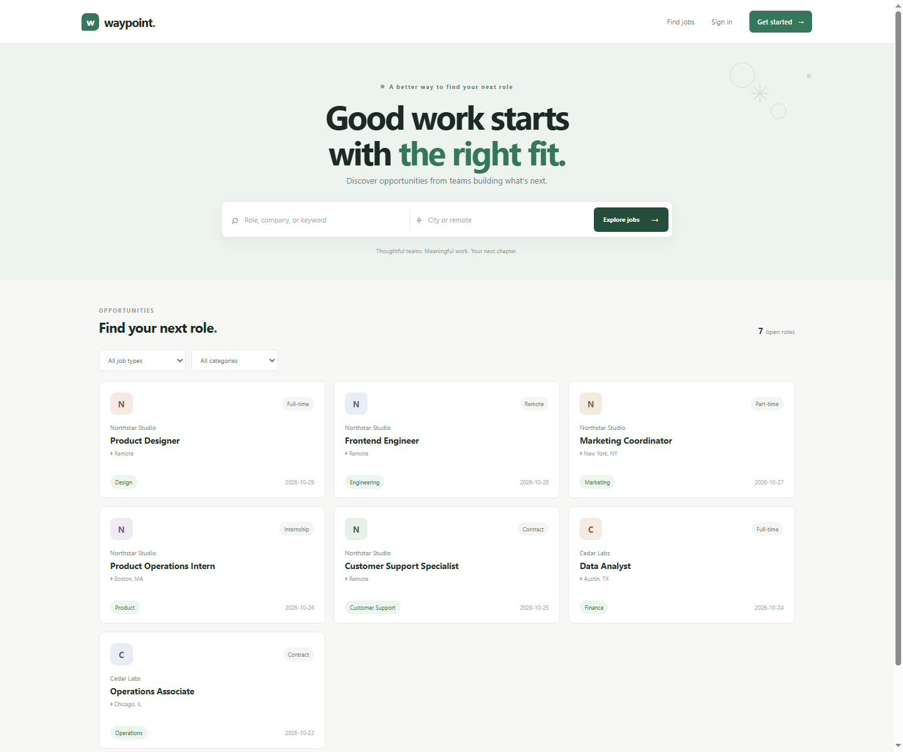
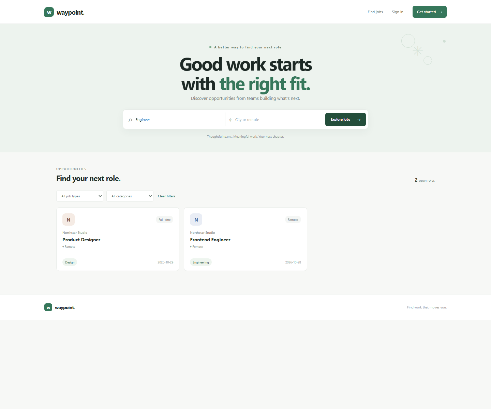
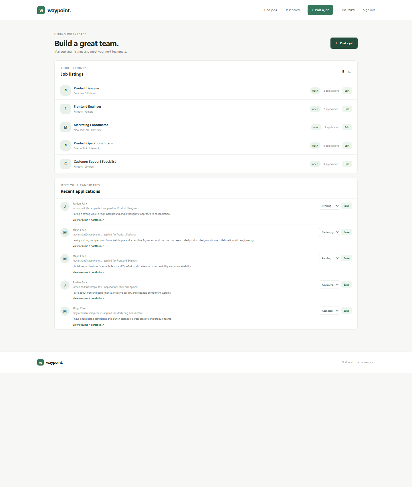

<div align="center">
  

  <h1>Waypoint Job Portal</h1>
  <p><strong>Find work that moves you.</strong></p>
  <p>A thoughtfully designed job marketplace for candidates, employers, and the people keeping the platform healthy.</p>

  <p>
    
    
    
    
  </p>
</div>

Waypoint brings job discovery, applications, and hiring into one responsive application. Candidates can find and track opportunities, employers can manage openings and review applicants, and administrators can oversee accounts and platform activity.

> **Project status:** This is a local-development and learning project. It has no production deployment configuration or license grant.

## What you can do

| Workspace | Capabilities |
| --- | --- |
| **Job seekers** | Search open roles by keyword and location; filter by work type and category; apply once per role with an optional portfolio/resume link and cover letter; track application status. |
| **Employers** | Create, edit, and close job listings; review candidate details and applications; update application statuses. |
| **Administrators** | View platform statistics and recent listings; activate or deactivate member accounts; manage job listings and applications. |
| **Everyone** | Browse job details, use responsive layouts, and receive clear validation and empty-state feedback. |

### Built-in safeguards

- Passwords are stored as Werkzeug password hashes, not plaintext.
- Forms use CSRF tokens; queries are parameterized; input and role/ownership checks are performed server-side.
- Session cookies use `HttpOnly` and `SameSite=Lax`; set `COOKIE_SECURE=1` when serving over HTTPS.
- Responses include a restrictive Content Security Policy and common browser security headers.
- SQLite data is kept in the ignored `instance/` directory by default.

These safeguards are not a production security certification. Review the application and deployment configuration for your environment before handling real user data.

## Screenshots

<p align="center">
  
  
</p>

The [complete feature screenshot gallery](screenshots/task-5-job-portal/README.md) includes all 25 Task 5 captures, descriptions, and demo-data notes.

The backend includes a job-deletion endpoint, but the current interface does not expose a delete control.

## Get started

Requires Python 3.10 or later. The application uses Flask and Python's built-in SQLite support.

### Windows (PowerShell)

```powershell
python -m venv .venv
.\.venv\Scripts\Activate.ps1
python -m pip install -r requirements.txt
$env:SECRET_KEY = python -c "import secrets; print(secrets.token_hex(32))"
python app.py
```

### macOS or Linux

```bash
python3 -m venv .venv
source .venv/bin/activate
python -m pip install -r requirements.txt
export SECRET_KEY="$(python -c 'import secrets; print(secrets.token_hex(32))')"
python app.py
```

Open [http://127.0.0.1:5001](http://127.0.0.1:5001). The app creates its SQLite database at `instance/jobs.sqlite3` on first request. For local work, it can generate a random secret key if `SECRET_KEY` is unset; set a persistent random value to retain sessions across restarts.

### Create the first administrator

With the virtual environment active, run:

```bash
python -m flask --app app create-admin
```

Follow the prompts to provide the administrator email, name, and password. Password input is hidden. Duplicate email addresses are rejected.

### Configuration

| Variable | Default | Purpose |
| --- | --- | --- |
| `SECRET_KEY` | Random per process | Flask session signing key. Set a persistent, high-entropy value outside local development. |
| `DATABASE` | `instance/jobs.sqlite3` | SQLite database file path. |
| `HOST` | `127.0.0.1` | Local development server bind address. |
| `PORT` | `5001` | Local development server port. |
| `COOKIE_SECURE` | Unset | Set to `1` to require HTTPS for session cookies. |
| `FLASK_DEBUG` | Unset | Set to `1` to enable Flask debug mode for local development only. |

The bundled Flask development server is not intended for public production hosting. Production deployment needs an appropriate WSGI server, HTTPS, persistent secret management, and deployment-specific operational and security review. Do not commit `.env` files or live database data.

## Run the tests

```bash
python -m unittest discover -s tests -v
```

The test suite uses temporary SQLite databases and exercises listing search, registration and authentication flows, application submission and review, role and ownership enforcement, CSRF rejection, and administrator setup.

## Project layout

```text
.
├── app.py                 # Flask routes, validation, and SQLite data access
├── instance/              # Local runtime database (ignored by Git)
├── static/                # Styles and client-side authentication helpers
├── templates/             # Jinja templates
├── tests/                 # unittest suite
└── screenshots/
    └── task-5-job-portal/ # Feature captures and gallery index
```

## License

No license is currently specified. All rights are reserved by default; contact the project owner before reusing or distributing this code.
